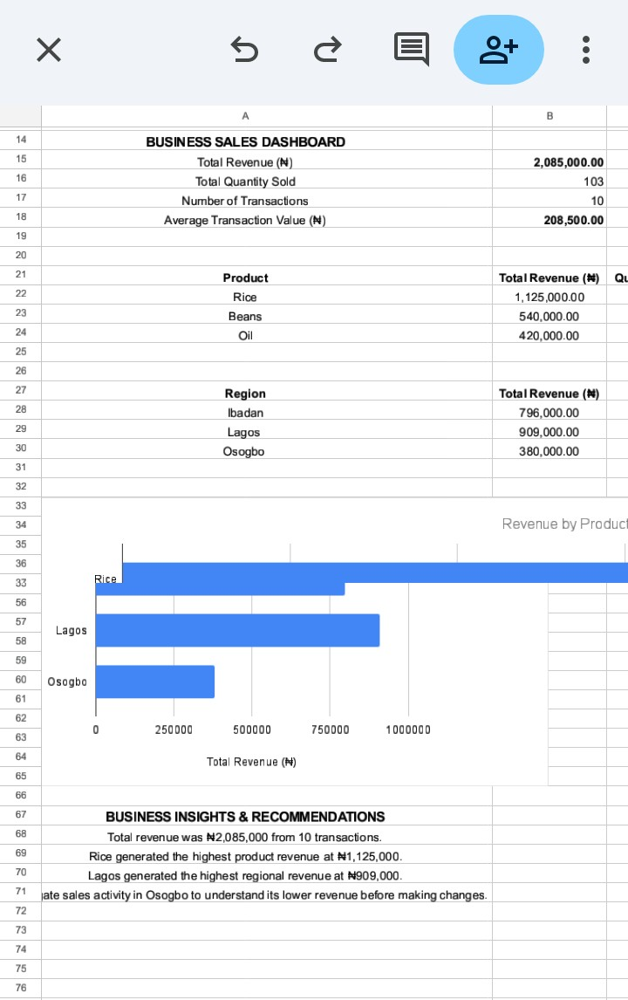

Business Sales Dashboard – Project 4

Project Overview

This project uses Google Sheets to analyse business sales data and build a dashboard showing revenue performance by product and region.

Business Objectives

- Calculate total revenue, quantity sold, number of transactions, and average transaction value.
- Identify the best-performing products.
- Compare revenue across regions.
- Provide actionable business recommendations.

Tools Used

- Google Sheets
- Spreadsheet formulas: "SUM", "AVERAGE", "COUNTA", and "SUMIF"
- Bar charts and dashboard visualisation

Key Performance Indicators

- Total Revenue: ₦2,085,000
- Total Quantity Sold: 103 units
- Number of Transactions: 10
- Average Transaction Value: ₦208,500

Key Findings

1. Rice generated the highest product revenue at ₦1,125,000.
2. Beans generated ₦540,000, while Oil generated ₦420,000.
3. Lagos recorded the highest regional revenue at ₦909,000.
4. Osogbo recorded the lowest regional revenue at ₦380,000.

## Dashboard Preview

Business Recommendations

- Review Rice inventory and customer demand to maintain product availability.
- Investigate sales activity in Osogbo, including customer demand, order volume, and product availability.
- Continue monitoring revenue by product and region to support informed business decisions.

Conclusion

The dashboard demonstrates how spreadsheet analysis can turn sales records into useful business insights. It provides a foundation for tracking performance and making data-informed decisions.

Note: The dataset contains 10 sample transactions and is intended for portfolio practice, not as evidence of actual client results.
